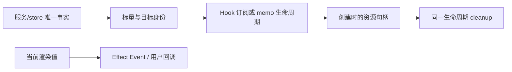

# Pre-push 告警清理

## 范围与基线

2026-11-14，用户推送后要求定位并修复代码行下有波浪线及说明的 warning。入口为 `.husky/pre-push` → `pnpm verify:pre-push` → `pnpm lint` 的 Oxlint 输出；工程测试选择器另外触发 Vite 的配置原生加载兼容提示。

基线根 Oxlint：278 条 exhaustive-deps、14 条未使用导入、24 条已登记的大文件提醒。修复闭包依赖、无用导入及配置兼容问题；保留已明确登记的大文件职责与提醒策略，不降低规则、不新增 lint 豁免、不为提醒机械拆分 owner。CLI 独立告警不混入本次 push 根入口的验收数量。

架构准入：五个已经入库的上游文件在原样时由 upstream snapshot 准入，编辑后恢复 `unmanaged-new-file` 检查。本次依照政策中的存量编辑惯例，只为这五个精确路径登记依赖/cleanup 修复；不更新 upstream snapshot，不接管整个 UI，不改变公共入口、状态 owner、跨模块 import 或禁用边界。后续改变接口或所有权须另行整理模块边界。

## 行为与所有权

- 原有服务、store、session owner/lease、workspace identity 与编译期硬禁用边界保持。UI 不复制服务事实，不增加轮询、兜底超时、缓存或写入路径。
- 回调依赖覆盖实际读取的标量、服务与回调；将 helper 的输入收窄到实际字段，避免仅为通过规则依赖整个 props、context 或 store 投影。
- effect 的订阅由目标身份和真实生命周期驱动；事件处理需要最新渲染值而不应重建订阅时，使用既有 React Effect Event。cleanup 释放创建时的 DOM/句柄，不从可能已经换代的 ref 读取释放目标。
- 业务上的 owner/revision 失效信号必须保留；删除仅无实际读取且不承担失效语义的依赖。草稿更新不触发恢复重放，配置编辑不重复初始化，流式更新不扩大无关渲染与 IO。
- Vitest 根配置显式声明 JSON import attribute，并使用 ESM 的 import.meta.dirname；原别名、工程清单和全量选择跳过规则不变。先补 Node 原生导入工程回归，禁止屏蔽 Vite 提示。

## 验收

静态执行 typecheck、根 lint、格式、架构与 whitespace 检查；Desktop Main 如有修改另做独立 noEmit。工程工具执行受影响 Node 回归与工程选择器预览，不运行 App 单测、应用、E2E 或制品构建。

人工场景：切换 workspace/session 后服务仍按 identity 隔离；草稿正文及 undo 不因编辑重放；插件、工作流与浏览器订阅切换后释放旧资源；语言/设置变化更新对应 UI，不重建无关订阅。未执行运行时场景时如实记录。

## 静态消融与结果

- 去掉依赖始终换代的五个远程连接点击回调 memo，以及侧栏两段纯 label 映射 memo；原本没有稳定性收益，保留完整事件体、禁用入口和时序守卫。共享 formatter、空列表、终端选项只按真实输入稳定，不增加持久缓存或资源生命周期。
- 曾考虑把 context、scope、services、entitlement 整体放进依赖；检查 helper 和调用点后仅保留实际标量与绑定回调，避免订阅/草稿初始化循环。项目排序方法单独绑定顺序和迁移映射，去掉展开/视图偏好对排序的额外失效。
- 保留 request owner、workspace identity、外部 store revision、草稿 generation 和 share preflight version 的失效信号，并用中文注释及显式读取表达其用途。删掉这些项虽然能减少依赖，但会跨 scope 沿用旧投影或旧请求令牌。
- DOM/集合 cleanup 捕获本生命周期的对象；代次与保存事务保留同一个 ref 容器并读取最新值，不把数字或事务快照冻结在 effect 创建时。思考档位的 RAF 状态移入 ResizeObserver/window resize 的 effect，确保重渲染后仍能取消对应帧。
- Vitest 原生加载回归先复现 `ERR_IMPORT_ATTRIBUTE_MISSING`，修复后通过；路径别名、工程清单和全量选择跳过策略保持。工程工具 Node 回归 27/27 通过；架构工程回归 61 通过、1 个文件模式用例按 Windows 平台跳过。
- 根 Oxlint 从 316 条降为 24 条：278 条 Hooks 依赖和 14 条未使用导入清零。保留的 24 条全部仍是原来相同文件上的 `max-lines` 提醒。两条 Hooks 规则对本次修改源码补做独立无忽略扫描，诊断为 0；没有降低规则或添加 lint disable。
- 根 typecheck、Desktop Main 独立 noEmit、lint、fmt:check、architecture:check --changed 与 git diff --check 已通过；完整 pre-push 链路在干净的本地提交上通过，工作区、远控目标、文档、SQLite schema 和架构门禁均正常。根 Vitest 配置变更按既有策略选中全部 169 个工程规格并跳过运行，不能把这一结果记为 169 个测试通过。
- 当前 Node 是 24.22.3，CLI 精确要求 24.22.2；pnpm 的 engine 提示属于工具版本差异，本次不修改 Node 全局安装或放宽仓库 pin。App/浏览器运行时场景未执行，静态检查不作为交互与渲染回归证明。

消融后、加入本节说明前，132 个已跟踪文件共新增 1089 行、删除 755 行（净增 334 行，含配置、回归与中文依据注释）；另新增本规格。没有新增生产源码文件、依赖、进程、定时器或写入 owner。
