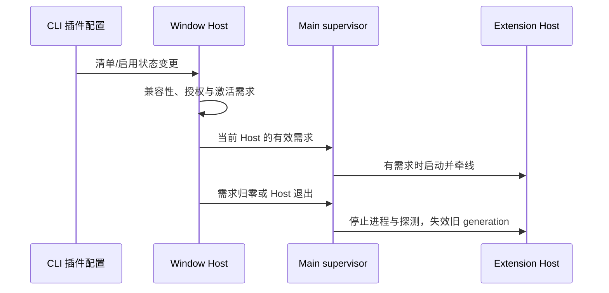

# v3.18.0 / v3.18.1 dev 同步与定制适配

## 基线与交付

- 起点为 dev `98d0f5a4`，合入 main `c5904686`（包含 `b95ebaff` v3.18.0 和 v3.18.1）。采用真实 merge；先提交合并及冲突裁决，再以独立提交记录定制适配。
- 最终只在 dev 本地 commit，不打 tag、不 push。保留上游本地能力及 dev 已有修复，不按文件整体覆盖任一侧。
- 遵循 `vendor-disable.md`、`remote-disable.md`、`dependency-upgrade-2026-11.md` 和 App 单测退役规格。已删除 ARMS、第一方 OTel 及专用 TTFT 资产不恢复；其余禁用实现、协议、文案保留。
- 保留 Node 24.22.2 项目 pin、Electron 44.10.2、MCP 2.4.0、zod 4.6.7 与 scoped overrides，以及其余现行 dev 工具链版本。新增依赖也适用；不修改全局 Node，不执行 mise install。

## 产品规则与所有者

- 所有硬禁用常量继续由 shared/env.ts 持有。服务装配、构造、注册、入口与启动恢复均须守卫；禁止为禁用域增加进程、采样、定时器、轮询、订阅、重连或无用途缓存。
- 新增官方语音输入依赖官方鉴权和 ASR，属于厂商禁用域：不装配服务、不挂载入口、不采集麦克风、不申请 ticket、不建立音频 WebSocket；保留实现、协议、i18n。
- CLI 内存诊断在 MEMORY_DIAGNOSTICS_ENABLED=false 时不启动 inspector、HeapProfiler、采样标识、bundle hash 和采样 IO；既有 resident session 维护节拍保留。
- Data Sync 新 provider、会话控制的远端 Source 发现、Sites 新发现/投影和 Bot 新派生路径均从源头关闭；普通本地会话、Web /ws、自配端点、手动市场、普通 cron 和 workflow 保留。
- 会话事实归 CLI，组织态归 Host；保留 identity/path 区分、owner/lease、CommandInbox admission、stale-run 和既有协议边界。已发布迁移校验与历史闲时任务行不改写。
- 保留 dev 草稿 session 终结清理；已登记 fork 归属问题只接收上游正式修复，不增加本地扫描/迁移 workaround。

## 本地 Extension Host 生命周期

- 保留本地扩展及其后台能力。CLI 是插件配置事实所有者；Window Host 是有效清单、兼容性、授权和激活需求所有者；Main 只管理进程、连接和存活探测，不复制插件业务状态。
- 用户启用、兼容且授权有效的 onAvailable 扩展可在没有会话或视图时后台工作。onCommand / onView 按原激活事件延迟运行，不因窗口 ready 就启动空扩展进程。
- 无运行代码、disabled、missing、invalid、incompatible、activation-held 或 declined 扩展不构成运行需求。静态 UI 声明不要求扩展进程。
- 有效需求到达后才启动、牵线、同步清单并激活。清单变更、禁用/卸载或最后一个 Window Host 退出造成需求归零时，停止进程及探测/重启；迟到的旧 Host、旧 generation 消息不能复活进程。
- 需求变化沿既有控制通道传递，采用当前 Host 身份和现有 generation 防护，不新增轮询、延迟回收定时器或第二份插件配置缓存。

## 验收场景

只进行静态验证；下列运行时场景保留为人工验收：

1. 无扩展、仅静态声明、禁用/无效/待授权扩展时，窗口就绪不产生扩展子进程、探测或重启工作。
2. 启用并授权 onAvailable 扩展后可后台运行；命令/视图扩展在实际触发前不执行；重复需求不重复启动。
3. 最后需求撤销、插件卸载或 Host 退出后进程和探测结束；并发重载、Host 重启、迟到消息不复活旧进程；后续有效需求可重新启动。
4. 自配模型、本地会话/重启/fork、受管 worktree、Design、普通 cron、手动插件和普通 Web 保持可用；草稿终结清理仍执行。
5. 旧 OAuth、ASR、Sites、Data Sync、远端 workspace、Bot、手机、闲时任务和遥测配置均不能触发入口、出网、采样或预热；数据库兼容，旧业务行和迁移校验保持。
6. App 业务单测不恢复；上游混合 session-control 测试按对象处理，保留 CLI 证据和必要工程门禁，不批量冒充 engineering。

## 验证与静态消融

- 合并前记录基线；合并后执行 typecheck、Desktop Main 独立 noEmit、根 lint（含 oxlint 与 session-control 边界）、CLI lint、fmt:check、architecture:check --changed、git diff --check。
- 额外以 `98d0f5a4` 固定基线检查整条合并链的架构与最终 diff；按实际改动执行 schema、架构及必要工程门禁。不运行 App 单测、应用、E2E 或制品构建。
- 修复本次合并带入的 error 和 warning，不降低规则；已有问题、未执行项、环境限制分开记录，skip 不记为通过。
- 适配完成后逐项审视条件、参数、状态、封装及依赖，删除重复分支，记录必需守卫和生命周期状态的依据及净变化，再重跑静态检查。
- 实测结果和消融结论在实施完成后补齐。
