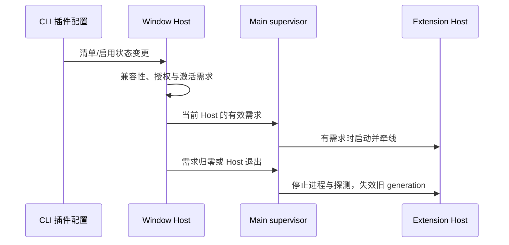

# v3.18.0 / v3.18.1 dev 同步与定制适配

## 基线与交付

- 起点为 dev `98d0f5a4`，合入 main `c5904686`（包含 `b95ebaff` v3.18.0 和 v3.18.1）。采用真实 merge；先提交合并及冲突裁决，再以独立提交记录定制适配。
- 最终只在 dev 本地 commit，不打 tag、不 push。保留上游本地能力及 dev 已有修复，不按文件整体覆盖任一侧。
- 遵循 `vendor-disable.md`、`remote-disable.md`、`dependency-upgrade-2026-11.md` 和 App 单测退役规格。已删除 ARMS、第一方 OTel 及专用 TTFT 资产不恢复；其余禁用实现、协议、文案保留。
- 保留 Node 24.22.2 项目 pin、Electron 44.10.2、MCP 2.4.0、zod 4.6.7 与 scoped overrides，以及其余现行 dev 工具链版本。新增依赖也适用；不修改全局 Node，不执行 mise install。

## 产品规则与所有者

- 所有硬禁用常量继续由 shared/env.ts 持有。服务装配、构造、注册、入口与启动恢复均须守卫；禁止为禁用域增加进程、采样、定时器、轮询、订阅、重连或无用途缓存。
- 新增官方语音输入依赖官方鉴权和 ASR，属于厂商禁用域：不装配服务、不挂载入口、不采集麦克风、不申请 ticket、不建立音频 WebSocket；保留实现、协议、i18n。
- CLI 内存诊断在 MEMORY_DIAGNOSTICS_ENABLED=false 时不启动 inspector、HeapProfiler、采样标识、bundle hash 和采样 IO；既有 resident session 维护节拍保留。
- Data Sync 新 provider、会话控制的远端 Source 发现、Sites 新发现/投影和 Bot 新派生路径均从源头关闭；普通本地会话、Web /ws、自配端点、手动市场、普通 cron 和 workflow 保留。
- 会话事实归 CLI，组织态归 Host；保留 identity/path 区分、owner/lease、CommandInbox admission、stale-run 和既有协议边界。已发布迁移校验与历史闲时任务行不改写。
- 保留 dev 草稿 session 终结清理；已登记 fork 归属问题只接收上游正式修复，不增加本地扫描/迁移 workaround。

## 本地 Extension Host 生命周期

- 保留本地扩展及其后台能力。CLI 是插件配置事实所有者；Window Host 是有效清单、兼容性、授权和激活需求所有者；Main 只管理进程、连接和存活探测，不复制插件业务状态。
- 用户启用、兼容且授权有效的 onAvailable 扩展可在没有会话或视图时后台工作。onCommand / onView 按原激活事件延迟运行，不因窗口 ready 就启动空扩展进程。
- 无运行代码、disabled、missing、invalid、incompatible、activation-held 或 declined 扩展不构成运行需求。静态 UI 声明不要求扩展进程。
- 有效需求到达后才启动、牵线、同步清单并激活。清单变更、禁用/卸载或最后一个 Window Host 退出造成需求归零时，停止进程及探测/重启；迟到的旧 Host、旧 generation 消息不能复活进程。
- 需求变化沿既有控制通道传递，采用当前 Host 身份和现有 generation 防护，不新增轮询、延迟回收定时器或第二份插件配置缓存。
- 监管器 idle 表示无有效需求（不是故障 stopped），不显示崩溃提示。命令/视图首次激活请求由 Host 持有需求，保持上游激活后直到禁用/卸载的生命周期；这份需求不是扩展运行状态副本。授权不足的代码不下发到扩展进程，撤销时重新计算需求和声明。
- 懒激活请求等待既有控制消息完成牵线及声明同步，不用轮询或超时。并发请求共享一次等待；需求归零、启动故障或 Host 销毁时明确 reject，旧代连接不能完成新请求。
- 数据泵的工作区及报告订阅跟随实际扩展消费者，最后一个消费者退订后清理草稿模型、修订号与速率聚合缓存；无消费者的直接查询不留修订号缓存。会话读取的最后一个登记释放后关闭本地 scope 及其工作区、runtime 订阅，后续读取按需重新建立。
- 每次按需重建读取 scope 使用新的 connectionId（扩展代际 + 随机唯一后缀），同代旧 scope 的异步清理不能退订新 scope；读取失败、主动退订与一次性读取结束共用登记释放路径。
- 扩展的审批回答、权限模式命令也标记为本地 desktop-continuous，仍沿用已有项目范围、授权、代际、幂等 commandId 与 CAS 防护；不接入手机 replayable 语义。Main 的手机附件桥及其凭据读取器只在手机功能装配分支内构造，禁用时不创建空闲附件 Map。
- 2026-11-12 用户补充裁决：允许扩展通过现有本地 connection scope 读取本机会话，使用 desktop-continuous 的可信身份、握手和释放机制；不使用上游新增的 web-remote-replayable 接入，不开放远程/手机/relay 入口。AGENTS 同步澄清该边界，其他既有协议分支保留。

## 验收场景

只进行静态验证；下列运行时场景保留为人工验收：

1. 无扩展、仅静态声明、禁用/无效/待授权扩展时，窗口就绪不产生扩展子进程、探测或重启工作。
2. 启用并授权 onAvailable 扩展后可后台运行；命令/视图扩展在实际触发前不执行；重复需求不重复启动。
3. 最后需求撤销、插件卸载或 Host 退出后进程和探测结束；并发重载、Host 重启、迟到消息不复活旧进程；后续有效需求可重新启动。
4. 自配模型、本地会话/重启/fork、受管 worktree、Design、普通 cron、手动插件和普通 Web 保持可用；草稿终结清理仍执行。
5. 旧 OAuth、ASR、Sites、Data Sync、远端 workspace、Bot、手机、闲时任务和遥测配置均不能触发入口、出网、采样或预热；数据库兼容，旧业务行和迁移校验保持。
6. App 业务单测不恢复；上游混合 session-control 测试按对象处理，保留 CLI 证据和必要工程门禁，不批量冒充 engineering。
7. 分组任务行在普通行与拖拽预览之间切换时，展示投影共用同一计算；交互子组件单独挂载，预览不挂载拖拽注册、菜单状态或路径 RPC。恢复普通行后，菜单、重命名、归档和任务状态仍遵循既有规则。工作流卡在紧凑态与折叠态切换时 Hook 顺序固定。
8. 三个 workspace 服务 Hook 在有路径和无路径间切换时保持调用顺序；无路径仍返回当前上下文服务，不额外要求 TabStoreProvider。有路径仍按 workspace 身份与连接状态解析，不能绕过断连边界；解析器使用既有可选 tab store 读取导航元数据，缺少导航上下文时显式远程身份仍返回断连代理。

## 验证与静态消融

- 合并前记录基线；合并后执行 typecheck、Desktop Main 独立 noEmit、根 lint（含 oxlint 与 session-control 边界）、CLI lint、fmt:check、architecture:check --changed、git diff --check。
- 额外以 `98d0f5a4` 固定基线检查整条合并链的架构与最终 diff；按实际改动执行 schema、架构及必要工程门禁。不运行 App 单测、应用、E2E 或制品构建。
- 修复本次合并带入的 error 和 warning，不降低规则；已有问题、未执行项、环境限制分开记录，skip 不记为通过。
- CLI lint 保留包内 cwd、Oxlint 版本和原参数；pnpm 的 npm_execpath 为 JavaScript 入口时经 Node 执行，为独立可执行文件时直接执行，Windows 的 pnpm.exe 不作为 JavaScript 加载。工程回归覆盖两种入口及带空格路径，禁止通过 shell 拼接参数。
- 根命令对 CLI 的排除放在根 lint/lint:fix 命令参数，不放入可继承的配置；CLI 包从自己的 cwd 运行时必须实际扫描 src，不能因继承根 ignore 而得到 No files found。工程回归用 CLI 目录中的违规源码验证扫描有效。
- 扩展清单的文件读取、授权重算和安装确认收口为无缓存的 inventoryReader；Window Host 继续独占表修订、发布及串行时序。两个上游新增的 UI Hook 分别登记为受管的 off-peak eligibility 与 onboarding record 边界，不通过放宽未受管新文件或长度规则解决门禁。
- 适配完成后逐项审视条件、参数、状态、封装及依赖，删除重复分支，记录必需守卫和生命周期状态的依据及净变化，再重跑静态检查。

### 实测结果（2026-11-14）

- 合并基线 `98d0f5a4`，上游 `c5904686`，merge commit `b96f5916`（两个父提交保留）；定制修复另行提交，不打 tag、不 push。
- 根 typecheck、Desktop Main 独立 noEmit、六份保留 CLI facade 测试的独立无构建类型检查通过。该 CLI 检查只解析 session-control 的源码公开入口，不以 bootstrap 的偶然 dist 产物作前提。
- 根 lint/Oxlint 通过；仍有 316 条存量 warning。CLI lint 通过，77 条存量 warning，另有 3 条原样上游行数诊断由既有准入处理。六份保留 CLI 测试的额外 Oxlint 扫描为 0 诊断。
- 用同一 Oxlint/规则重扫合并前 worktree，以文件、规则、消息及所在 Hook 调用的词法指纹对照；根和 CLI 本次新增/改动诊断均为 0。根忽略的基础组件、AI 组件、CUA 与 CLI React 源码补做两条 Hooks 专项扫描，21 条存量 warning，新增 0；CLI 部分与独立 lint 有覆盖重叠，不相加为总数。这不宣称全库零 warning。
- 原七个 Hooks 调用位置降级例外全部移除；123 条编译期开关提前 return 引出的条件 Hook error，以及上游登记的 20 条调用位置 warning 均已修复。模块装配选择保留原业务实现，禁用域不进入 Hook 或构造服务。
- 根格式检查和 CLI 定制改动文件的包内格式检查通过。默认架构基线与固定 `98d0f5a4` 的整条合并链均为 0 violation；global policy 和 exceptions 与 merge commit 完全一致。`git diff --check` 通过。
- schema 门禁的 8 个工程回归和两份 SQLite baseline 兼容检查通过。5 份既有任务库迁移、24 份既有 CLI 迁移定义及冻结辅助 SQL 输入保持不变，两边各追加 1 份上游迁移；不改写历史闲时任务业务行。
- 架构工程回归 62 项：61 通过，1 项文件模式回归因 Windows 平台 skip；CLI lint 工程回归 3 项全部通过。退役 App 证据检查通过，新增 App 业务测试为 0；混合 session-control 测试中的 CLI 用例移至 CLI 自有入口。
- 工程受影响选择器选中全部 169 个规格，按仓库现行策略跳过全量，未把 skip 写成通过。远程 E2E 目标静态检查因私有队列缺失 skip；没有执行 App 单测、应用或 E2E 运行时验收。上面的人工场景尚未运行。
- 最终执行环境 Node 24.22.3、pnpm 11.27.1、Oxlint 1.91.0；仓库 Node pin 仍为 24.22.2，CLI 的 exact engine 提示如实保留。安装早期 pnpm 隐式触发的一次 prepare 已中止，后续安装使用 `--ignore-scripts`，脚本执行关闭自动依赖安装；没有以制品构建作为验证证据。

### 消融结论

- 删除手写 deferred 的冗余 resolver 闭包和重复类型，改用既有运行时已支持的 `Promise.withResolvers`；激活等待与日志请求仍各只有一个 owner，不引入超时、轮询或第二条结算路径。
- 删除数据泵的重复 active 状态，直接使用真实报告订阅的存在与身份判断需求；查询跨过退订/重新订阅时，旧回包不写入新订阅的修订缓存。最后消费者退订时清理报告/CLI 监听与缓存。
- 删除会话读连接的闲时保留、已释放登记的 mirror 引用和多余数组复制；失败、退订、一次性读取结束复用登记释放路径。保留每次 scope 的唯一后缀，避免同代旧清理伤及新读取。
- 保留 Main 的 ready/required 和 generation：分别表达控制通道就绪、有效运行需求和异步代际，不能合并为进程是否存在；Host 的激活需求 Set 只记录已接受的激活寿命，不复制运行状态。重启和探测均沿用原机制，只在存在需求时运行。
- 保留编译期装配守卫与调用点守卫：前者保证禁用域不构造服务、桥、空闲 Map 或监听；后者避免未注册跨进程 channel 的超时。没有新增运行时开关、禁用版服务实现或恢复入口。
- 清单 IO 仅下沉到无缓存适配器，静态表修订、发布与串行链仍归 Window Host；两个新 UI 接缝只登记现有 Hook 的边界，没有额外服务或状态。扩展门面保持在 800 行限制内，未增加长度例外。
- 逐项核对 Hook 读取和失效边界，移除实际未读取的依赖与死回调；需要按 owner 更换的屏障与预热保留 owner 身份，草稿正文通过 Effect Event 在恢复时读取，不因逐字编辑重放恢复。没有机械依赖整个 settings、preview context、shell 或 model view 对象。
- 相对 merge commit，第一方 `.ts/.tsx/.mjs` 变更（排除 test/tests/fixtures 目录，包含格式与注释）为 118 个文件、+2124/-1672 行，净 +452；此为物理 diff 行数，不等同复杂度。删除无效状态和监听后，剩余新增量主要用于需求协议、资源回收、源头守卫及明确的模块边界。消融后重跑类型、lint、格式、架构与 whitespace 检查。
