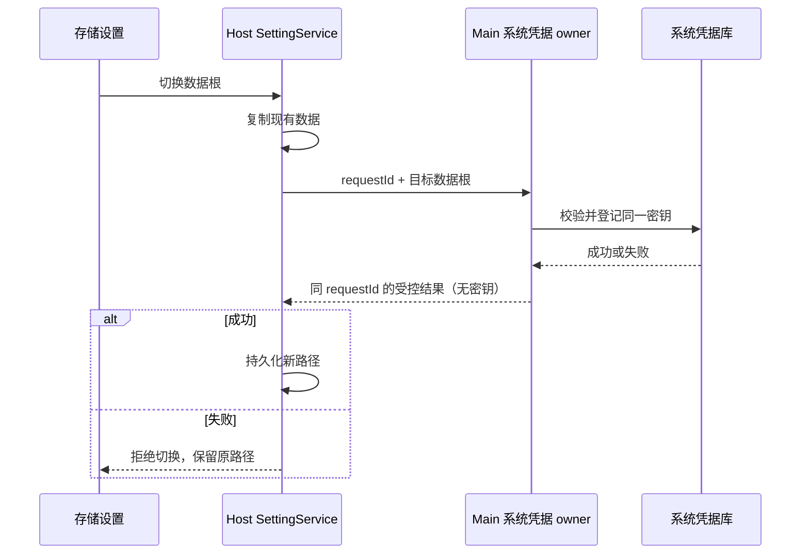

# v3.18.2 dev 同步与定制适配

## 基线与交付

- 从 dev `2ffbfbda` 合入 main `fec97590`（v3.18.2）；共同祖先为 `c5904686`。
- 保留双方历史，以一个 merge commit 包含合并、冲突解决、禁用适配和必要检查修复；只本地 commit，不打 tag、不 push。
- 保留 dev 的工具链、依赖、许可证库存、原生模块与打包定制。产品版本接收 3.18.2，不用上游旧清单覆盖 dev 的依赖升级。
- 遵循 `vendor-disable.md`、`remote-disable.md`、`dependency-upgrade-2026-11.md` 及各项现行定制规格。已删除的 ARMS、第一方 OTel 不恢复；其他禁用实现、协议、文案保留。

## 产品规则与所有者

- 编译期禁用常量仍由 shared/env.ts 唯一表达。官方账号、Coding Plan、Start Plan、Highspeed、闲时任务、遥测、内存诊断、自动更新、远程 workspace、手机、Bot、Data Sync、Sites 和市场自动刷新均不重新进入或持有后台资源。
- Start Plan 新材料、JWT 与家族映射属于既有 Coding Plan 禁用域。Host 在装配处不构造账号鉴权/连接解析器及其缓存；新读取方法和可直接调用的解析边界在读设置、OAuth 凭据或发请求前返回。不得用 UI 隐藏代替源头禁用；自配模型和共享本地凭据恢复保持可用。
- 相关链路既有的项目 Token、账号连接订阅及 quota/TPS 缓存也在装配处跳过；TPS 方法补齐禁用早退，不能因其他用量方法已有守卫而遗漏。ProviderRuntime 复用现有缺省的 fail-closed account source，不另建禁用版实现；本地 App Usage 继续读 CLI 统计。
- 接收本地凭据修复，安全合同以 `docs/plans/2026-10-29-system-credential-storage.md` 和 credential-security 合同为准。数据根迁移不是跨设备 Data Sync，不受 DATA_SYNC_DISABLED 拦截。
- Main 独占系统密钥。Host 的 SettingService 先复制数据，再经既有私有通道请求 Main 登记目标根密钥；成功后才保存目标路径。目标密钥不同或登记失败时拒绝切换，不覆盖目标密钥、不删除旧根、不向 Host 返回密钥。
- Linux Desktop Main 在首次凭据访问前启用私有文件 fallback。仅未绑定来源、无 v2 密文的目录允许系统库失败后发布随机强密钥私有文件；文件权限 0600，锁内排他发布。已绑定 OS 的目录失败关闭，不自动切源。Windows/macOS、独立 CLI 和 Server 不开启该策略，Host/内置 CLI 跟随 Main。
- 接收 PowerShell Authenticode 对 ConstrainedLanguage 与 Unicode 的兼容修复，保留失败关闭、不提权、不修改设备策略；自动更新入口继续硬禁用。
- 本地扩展需求与 generation、控制面闲时回收、会话 owner/lease、workspaceIdentity、CommandInbox、数据库迁移校验、普通 cron、手动插件和 Web /ws 等既有边界保持。
- 构建期可选能力文档改为当前硬禁用合同，不再声称环境变量或私有默认配置能开启遥测、ARMS 或自动更新。

## 验收场景

仅运行静态检查和允许的工程/CLI 回归；下列运行时场景保留为可重复人工验收，不声称已经执行。

1. 保留旧官方登录、Start Plan 与套餐选择后启动，进入模型设置并请求账号解析：不读取官方 OAuth 材料、不发 JWT/权益/额度请求、不创建官方解析缓存；自配 API Key 模型仍能正常解析凭据。
2. Windows/macOS 下切换数据目录，复制与密钥登记都成功后才保存路径；重启后现有本地模型凭据可用。目标存在不同密钥或登记失败时路径不变，旧数据仍可读。
3. Linux 首次使用无 keyring 的未绑定目录时，按需生成私有强密钥文件；并发初始化只有一个发布结果。已绑定 OS 或已有 v2 数据时，keyring 故障不得转用其他来源。
4. 独立 CLI/Server 与 Windows/macOS 不自动启用 Linux fallback；显式受管密钥和既有私有文件发现仍遵循原安全合同。
5. PowerShell 签名检查在受限语言模式下正确处理中文身份和单引号，拒绝换行/NUL 等非法参数，错误路径不放行；这不恢复自动更新。
6. 无扩展运行需求时不冷启动进程；本地会话、普通 cron、手动市场与 Web 通道可用。所有永久禁用域的新旧入口均不构造后台工作，旧闲时任务行及已发布迁移不改写。

## 验证与静态消融

- 实施前运行 freshness 与架构基线，读取 credential-security、desktop、services 的受控上下文。
- 最终执行根 typecheck、Desktop Main 独立 noEmit、根 lint/Oxlint、CLI 独立 lint、格式、默认和固定 dev 基线的架构检查、git diff --check；复核改动 React 文件的 Hooks 诊断。
- 按变化执行 PowerShell/worker 环境工程回归、CLI 凭据安全回归、schema、架构、文档及许可证门禁。受影响选择器的 skip 必须单列，不算通过。不启动应用、不运行 E2E 或制品构建。
- 用户要求所有相关检查通过；与本次无关但阻塞检查的已有问题也可修复，不放宽检查规则或新增豁免。
- CLI fallback 回归在 Windows 仍执行加解密、来源绑定与并发场景；仅 POSIX 文件模式断言按现有凭据回归惯例限于非 Windows，Windows 的 stat 模式不表达 0600 权限。Linux 的 0600 断言保持。
- 逐项审视新增条件、状态、依赖和封装，移除重复守卫或无用途缓存；保留源头装配守卫和直接调用保护的不同职责。完成后记录净代码变化与验证结果。

### 实测结果（2026-11-15）

- freshness 与初始架构检查通过，合并前工作区干净。四处文本冲突按上述规则裁决；依赖 pin、锁文件、编译期禁用常量、架构策略和既有迁移均未改动。
- 根 `pnpm typecheck`、Desktop Main 独立 `tsc --noEmit`、根 lint/Oxlint、CLI 独立 lint、根格式、CLI 两份凭据测试的包内格式和 Oxlint 检查通过。根仍有 24 条存量行数 warning，所在文件均未被本次修改；CLI 为 0 error、77 条存量 warning，另有 3 条既有原样上游行数诊断。未降低规则或新增豁免。
- 两个改动的 React 文件用仅启用 exhaustive-deps / rules-of-hooks 的独立配置扫描，当前与合并前内容均为 0 诊断；未触及根忽略的 UI 源码。没有运行界面或宣称渲染行为已经验证。
- PowerShell 与 worker 环境工程回归：2 文件、30 项通过。CLI 凭据安全回归：2 文件、42 项通过。上游 fallback 测试的两处 POSIX 模式断言在 Windows 失败，按既有平台边界修正后全部通过；Linux 权限断言仍保留。CLI 上游凭据测试的包内格式问题同步修正。
- SQLite schema 门禁：8 项工程回归通过，两份现有 baseline 兼容检查通过。架构工程回归：62 项，61 通过，1 项文件模式检查因 Windows 平台 skip。
- 默认架构基线与固定 `2ffbfbda` 的整条合并链均为 0 violation；`git diff --check` 与过时文档短语门禁通过。
- 工程受影响选择器（固定 `2ffbfbda`）选中 169/169，按现行策略跳过全量，未将其记为测试通过；上面的 30 项工程回归另行实际执行。
- 许可证基础检查通过，2359 个实装包；保留已登记的 19 项材料核验限制，不宣称严格发布合规完成。重新生成声明后声明正文未变化，库存只更新根产品版本与既有锁文件的输入指纹，依赖版本没有变化。
- 执行环境为 Node 24.22.3、pnpm 11.27.1；项目 Node pin 保持 24.22.2，exact engine 提示保留。早期两次 pnpm 隐式安装触发 prepare（CUA 的 `tsc --noEmit`），后续通过既有 `PNPM_CONFIG_VERIFY_DEPS_BEFORE_RUN=false` 关闭自动安装。未启动 App、执行 App 业务单测、E2E 或制品构建。

### 静态消融结论

- ProviderRuntime 直接复用已有缺省 fail-closed account source，删除禁用状态下的账号服务构造与刷新订阅，没有新增替代服务或第二份事实。
- 把循环内部较晚的套餐守卫提升到解析入口，删除重复循环守卫，保证读取设置、OAuth 和创建单轮 Map 之前就返回。OAuth snapshot 共用守卫覆盖新 Start 材料；移除新材料方法上重复的同值判断，另保留直读 active provider 的独立边界。
- resolveCurrent 与 assertCurrent 共用内部 access 拒绝路径，避免重复判断；公开 resolveAccessCurrent 另有直接调用边界。Host 装配守卫仍必需，因为方法早退不能阻止项目 Token、账号连接、quota 和 TPS 缓存的构造。
- 保留 Main/Host 密钥登记的 requestId、pending Map、目标 keyring 锁、来源标记和指纹校验，分别承担请求关联、并发排他与来源固定；不引入超时、轮询或第二个密钥 owner。保留 Linux 仅 Main 开启的策略及失败缓存，避免重复系统授权。
- 相对起始 dev，第一方 `.ts/.tsx/.mjs/.mts`（仅 packages/apps，排除 test/tests/fixtures 目录，包含配置、声明与注释）为 22 文件、+798/-231 行，净 +567；这是包含上游功能的物理 diff，不等同复杂度。消融后重跑根类型、Main 类型、根/CLI lint、格式及固定基线架构检查。
